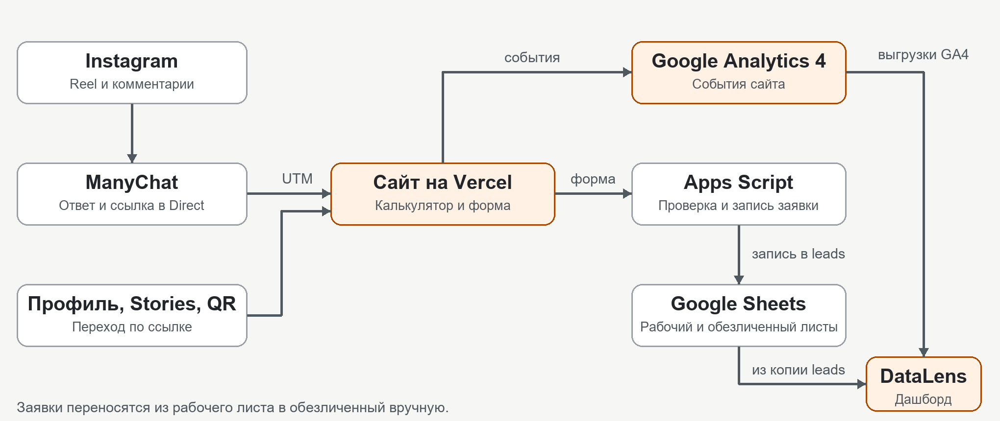

# ООО «Квадрат Ремонт» — сайт и аналитика заявок

| Ресурс | Ссылка или статус |
| --- | --- |
| Сайт на Vercel | [Квадрат Ремонт](https://tz-13-remont-kvadrat.vercel.app/) |
| Репозиторий | [GitHub](https://github.com/stvxs/tz-13-remont-kvadrat) |
| Google Sheets | Передача ссылки преподавателю пропущена. [Кадр контрольной заявки](screens/utm/i03-sheets-u02.png) |
| Дашборд DataLens | Передача ссылки и выдача доступа преподавателю пропущены. Кадры вкладок [«Трафик»](screens/datalens/datalens-traffic-instagram-generate-lead-nov09.png), [«Заявки»](screens/datalens/i10-leads-contract-nov17.png) и [«Кампании»](screens/datalens/i09-campaigns-summary-nov03-nov17.png) |
| Instagram | [Профиль с U‑01](https://www.instagram.com/andrytailorr/) · [Reel с автоответом U‑02](https://www.instagram.com/p/Dff9EANTnYL/) · [Реестр размещений](docs/utm.csv) |
| Материалы курсовой | [Бланк](docs/kursovaya.md) · [Описание работы](docs/opisanie.md) · [Отчёт о проверках](docs/report.md) · [Схема](docs/scheme.png) |
| Презентация к защите | [PDF](presentation/zashchita.pdf) · [PPTX](presentation/zashchita.pptx) |

**Measurement ID GA4:** `G-MNWBR6TDY7`  
**Доступ Viewer к ресурсу GA4:** шаг выдачи доступа пропущен, поскольку адрес электронной почты преподавателя неизвестен.

Курсовая работа по дисциплине ОП.03 «Информационные технологии», ТЗ № 13/2026.  
**Исполнитель:** Орищенко Ян Владиславович, группа 11/1-РПО-26/1.

Сайт знакомит клиентов с услугами компании и рассчитывает ориентировочную стоимость и срок ремонта. Успешные заявки попадают в Google Sheets вместе с UTM-метками, а DataLens показывает обезличенные заявки по источникам и статусам.

## Что сделано

| Часть проекта | Результат |
| --- | --- |
| Сайт | 9 страниц и 404. В контрольном расчёте И‑13 — 388 000 ₽ за работы, 135 800 ₽ за материалы и 48 дней. Мобильный Lighthouse на Vercel: Performance 95, Accessibility 94, SEO 100. [Кадр замера](screens/site/mobile/lighthouse/lighthouse-mobile-summary.png) |
| GA4 | Настроен веб-поток для Vercel, `generate_lead` отмечено как ключевое событие. Проверенные события и параметры перечислены в [таблице событий](docs/events.md). |
| UTM | 12 позиций в реестре, 10 собранных ссылок. Проверены переходы из профиля, Reel и Stories. Для QR подтверждены сканирование и заявка с метками. [Реестр](docs/utm.csv) · [Афиша](docs/afisha.pdf) |
| Заявки | Форма передаёт данные через Apps Script в лист `leads`. Проверена запись заявки с четырьмя метками U‑02 и обработка повторного `request_id`. [Подробности](docs/opisanie.md#6-заявки) |
| ManyChat | Ветка «ПРИЁМКА» под Reel отправляет публичный ответ и кнопку в Direct. Ветка «САНУЗЕЛ» активирована и ждёт подтверждения срабатывания. [Кнопка в Direct](screens/instagram/manychat-priemka-test-direct.jpg) |
| Отчёты | И‑09 подтверждён частично: при смене периода сводка и обезличенный лист показали 4 тестовые заявки, рабочая таблица — 5. После ручного переноса контрольной заявки в И‑10 DataLens показал 5 тестовых заявок, из них 2 со статусом `contract`. В И‑12 переключение воронки подтверждено, числа совпали в обоих режимах на всех трёх срезах. [Результаты проверок](docs/report.md) |

## Технологии и структура

HTML, CSS, JavaScript, Google Analytics 4, Google Sheets, Google Apps Script, ManyChat, Yandex DataLens, GitHub и Vercel.

- HTML-страницы, `css/`, `js/`, `img/` и `files/` — сайт и его материалы.
- [apps-script/](apps-script/) — приёмник заявок.
- [docs/](docs/) — описание, отчёт, реестр UTM, таблица событий и схема.
- [screens/](screens/) — сохранённые кадры проверок.

**Не получилось.** Публикации во ВКонтакте, Telegram и YouTube не выполнены. Для партнёрских размещений нужны данные партнёров. Публичное размещение афиши и источник QR в GA4 не подтверждены. Успешное срабатывание второй ветки ManyChat и ожидаемое в И‑12 изменение чисел воронки не подтверждены.

**Нейросеть использовалась для** помощи с HTML, CSS, JavaScript, настройкой аналитики, проверкой кода и подготовкой документации. [Журнал запросов](docs/prompts.md)
