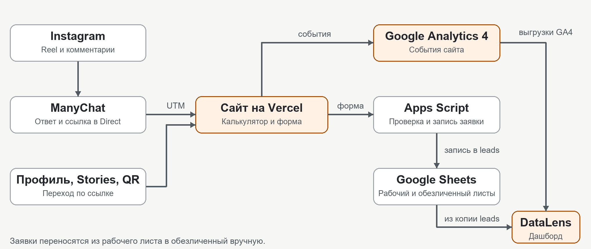

# Описание работы · ТЗ № 13/2026 · «Квадрат Ремонт»

**Исполнитель:** Орищенко Ян Владиславович, группа 11/1-РПО-26/1  
**Сайт:** [Квадрат Ремонт на Vercel](https://tz-13-remont-kvadrat.vercel.app/)  
**Период данных в описании:** 6 октября — 17 ноября 2026 года. Даты отдельных срезов указаны рядом с результатами.

## 1. Задача заказчика

По письму заказчика, в сентябре 2026 года компания получила 140 вопросов, провела 41 выезд и заключила 9 договоров. Компания хотела выяснить, на каком шаге теряются клиенты и какие каналы приводят к договору. Для предложения «Смета за 24 часа и фиксированная цена в договоре» подготовили сайт с калькулятором и форму, которая сохраняет источник заявки в таблице. В таблице менеджер ведёт заявку по статусам.

## 2. Схема работы

Посетитель переходит на сайт по UTM-ссылке, например из сообщения ManyChat или по QR-коду. Сайт отправляет события в GA4, а форму передаёт в Google Sheets через Apps Script. DataLens читает выгрузки GA4 и обезличенные заявки из Google Sheets. Заявки из рабочего листа переносятся в обезличенный вручную. Во вкладке «Кампании» используется сводка по дате, источнику и кампании.

## 3. Сайт

На Vercel опубликованы главная, услуги, калькулятор, портфолио, этапы ремонта, чек-лист, контакты, страница благодарности, политика конфиденциальности и страница 404. В контрольном примере И‑13 капитальный ремонт 40 м² с демонтажем и без санузла дал 388 000 ₽ за работы, 135 800 ₽ за материалы и 48 дней. Значения расчёта сверены с параметрами `repair_calc` в DebugView.

В сохранённом мобильном замере Lighthouse для главной на Vercel показатели Performance, Accessibility и SEO составили 95, 94 и 100 соответственно.

[Мобильная навигация](../screens/site/mobile/mobile-home-navigation-fixed.jpg) · [Контрольный расчёт](../screens/site/calculator-control-I13.png) · [Lighthouse на Vercel](../screens/site/mobile/lighthouse/lighthouse-mobile-summary.png)

## 4. Аналитика GA4

В ресурсе «КВАДРАТ — сайт» настроены московский часовой пояс, рубли и веб-поток `G-MNWBR6TDY7` с адресом на Vercel. Улучшенная статистика включает взаимодействия с формами. В DebugView проверены, в частности, события калькулятора, CTA, портфолио, этапов, скачивания PDF и отправки формы. `generate_lead` отмечено как ключевое событие. Проверенные параметры перечислены в таблице событий.

[Настройки ресурса](../screens/ga4/ga4-admin-property-settings.png) · [Веб-поток](../screens/ga4/ga4-admin-web-stream-vercel.png) · [Настройки форм](../screens/ga4/ga4-admin-enhanced-measurement-forms.png) · [Таблица событий](events.md)

## 5. UTM-ссылки и публикации

В реестре 12 позиций и 10 собранных ссылок. Подтверждены размещения U‑01 в профиле Instagram, U‑02 под Reel и U‑04 в Stories. Для U‑12 подготовлена афиша с QR-кодом. Сканирование и заявка с метками подтверждены, публичное размещение и появление источника QR в GA4 не подтверждены.

[Реестр UTM](utm.csv) · [Афиша](afisha.pdf) · [Instagram в Traffic acquisition](../screens/ga4/reports/ga4-traffic-acquisition-instagram-social-oct06-nov03.png)

## 6. Заявки

Форма передаёт поля и UTM-метки в Apps Script, который проверяет данные и записывает заявку в лист `leads`. Повторный `request_id` не создаёт вторую строку и возвращает ошибку.

17 ноября в испытании И‑03 с телефона открыли U‑02 и отправили контрольную заявку. В рабочей таблице появилась строка со статусом `new` и метками `instagram / social / estimate_nov_2026 / reel_timelapse_01`. По наблюдению участника, это произошло в пределах двух минут. В Realtime после отправки общий счётчик показал одно событие `generate_lead`. В таблице контрольное имя записано прописными буквами и с «Е» вместо «Ё».

[Контрольная строка в Sheets](../screens/utm/i03-sheets-u02.png) · [Счётчик GA4 Realtime](../screens/ga4/i03-realtime-generate-lead.png)

## 7. Автоответы в Instagram

Под Reel «Двушка за 60 дней» комментарий «ПРИЁМКА» запускает публичный ответ и сообщение в Direct. Кнопка ведёт на чек-лист по U‑02. В отдельной проверке ветки подтверждена запись заявки с UTM. Ветка «САНУЗЕЛ» с кнопкой по U‑03 активирована, но при повторном комментарии с того же аккаунта ответ не пришёл. Успешное срабатывание второй ветки пока не подтверждено.

[Reel](https://www.instagram.com/p/Dff9EANTnYL/) · [Публичный ответ](../screens/instagram/manychat-priemka-test-comment.jpg) · [Кнопка в Direct](../screens/instagram/manychat-priemka-test-direct.jpg) · [Открытие чек-листа](../screens/instagram/manychat-priemka-test-landing.jpg) · [Заявка с UTM](../screens/instagram/manychat-priemka-test-lead-utm.png) · [Настройка второй ветки](../screens/instagram/manychat-sanuzel-live.png)

## 8. Отчёты GA4 и дашборд DataLens

**И‑11.** За 06.10–17.11.2026 среди входов из Instagram наибольшее число ключевых событий было у `/index.html` — одно за 14 сеансов. В отчёте использованы параметры «Целевая страница» и «Источник сеанса» и показатель «Ключевые события».

**И‑12.** При переключении открытой и закрытой воронки числа совпали на каждом из пяти шагов во всех трёх срезах. Кадры обоих режимов сохранены за первый период.

| Период | Активные пользователи по пяти шагам в обоих режимах |
| --- | --- |
| 06.10–03.11.2026 | 10 → 3 → 3 → 3 → 3 |
| 06.10–17.11.2026 | 23 → 3 → 3 → 3 → 3 |
| 09.11–17.11.2026 | 13 → 0 → 0 → 0 → 0 |

Открытая воронка допускает вход с любого шага, закрытая — с первого. И‑12 подтверждён частично. Переключение показано, ожидаемого в ТЗ изменения чисел на этих срезах не наблюдалось.

[Отчёт по входам из Instagram](../screens/ga4/reports/i11-landing-page-instagram.png) · [Открытая воронка](../screens/ga4/explorations/i12-funnel-open-oct06-nov03.png) · [Закрытая воронка](../screens/ga4/explorations/i12-funnel-closed-oct06-nov03.png)

**И‑09, частично подтверждён.** Во вкладке «Кампании» расширили период с 09.11 до 03–17.11.2026. В сводке стало 4 заявки и 1 договор. Число заявок совпало с обезличенным листом за тот же период. В рабочей таблице уже была пятая заявка из И‑03, которую к этому моменту ещё не перенесли.

**И‑10.** Затем в рабочей таблице сменили статус этой заявки с `new` на `contract` и вручную перенесли её в обезличенный лист. После обновления вкладка «Заявки» без фильтров даты и статуса показала **5 заявок и 2 договора**. Контрольная заявка видна с источником Instagram и исходными UTM.

[И‑09 — «Кампании»](../screens/datalens/i09-campaigns-summary-nov03-nov17.png) · [И‑10 — «Заявки»](../screens/datalens/i10-leads-contract-nov17.png)

## 9. Что получил бизнес

| Задача | Что показывает проект |
| --- | --- |
| Быстро ответить на вопрос о цене | Калькулятор показывает ориентир по стоимости и сроку до обращения к сметчику. |
| Увидеть источник заявки и её статус | Форма сохраняет UTM в таблицу, а DataLens показывает обезличенные заявки по источникам и статусам. |
| Разобраться, где посетитель останавливается | GA4 позволяет сравнивать шаги от просмотра страницы до отправки заявки. |

В срезе И‑12 за 06.10–17.11 самая большая потеря произошла между просмотром страницы и выбором типа ремонта. До второго шага дошли 3 из 23 пользователей. На рабочем трафике можно проверить гипотезу, что более заметная кнопка перехода к калькулятору увеличит долю пользователей, выбравших тип ремонта. Сохранённые данные включают тестовые действия и не дают основания перераспределять рекламный бюджет.

## 10. Итог

Подтверждён путь от перехода по U‑02 до заявки с метками и отображения её статуса в DataLens. Публикации во ВКонтакте, Telegram и YouTube не выполнены, партнёрские размещения остаются открытыми. Вторая ветка ManyChat требует подтверждения. Карточка активных пользователей в DataLens показывает итог за фиксированный период, селекторы её не пересчитывают.

ChatGPT использовался для помощи с HTML, CSS, JavaScript, настройкой аналитики и подготовкой документации. Предложенный код проверялся и дорабатывался вручную.

[Отчёт о проверках](report.md) · [Журнал запросов к ИИ](prompts.md)
