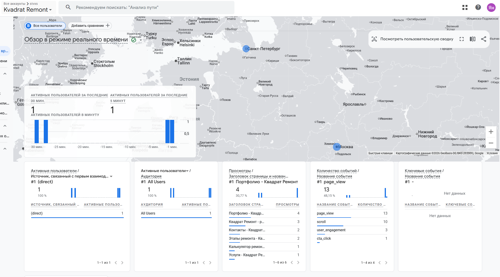
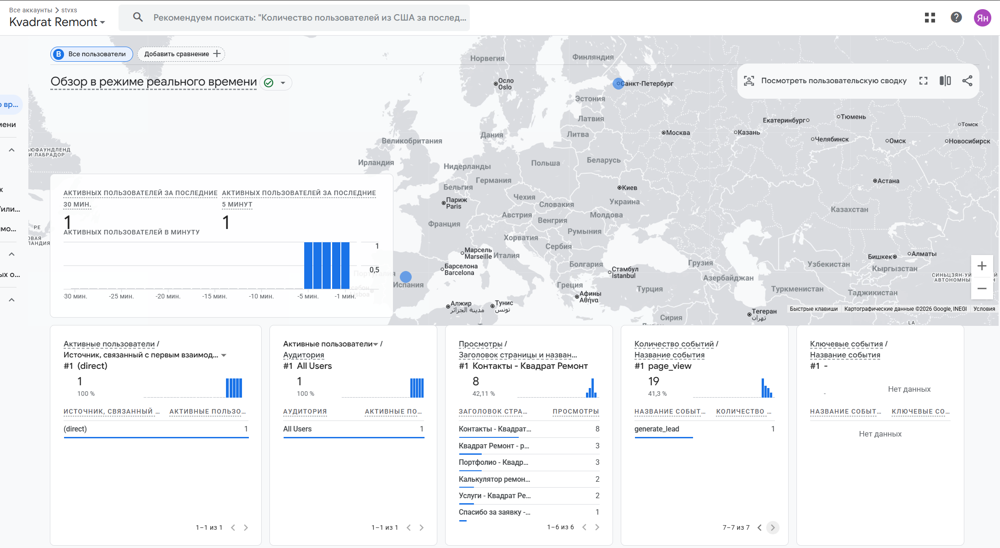
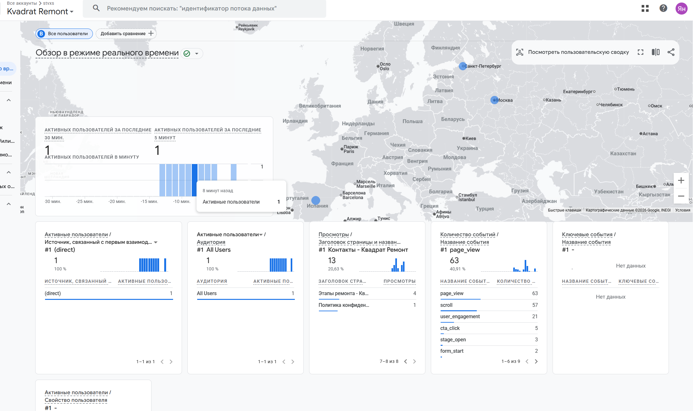
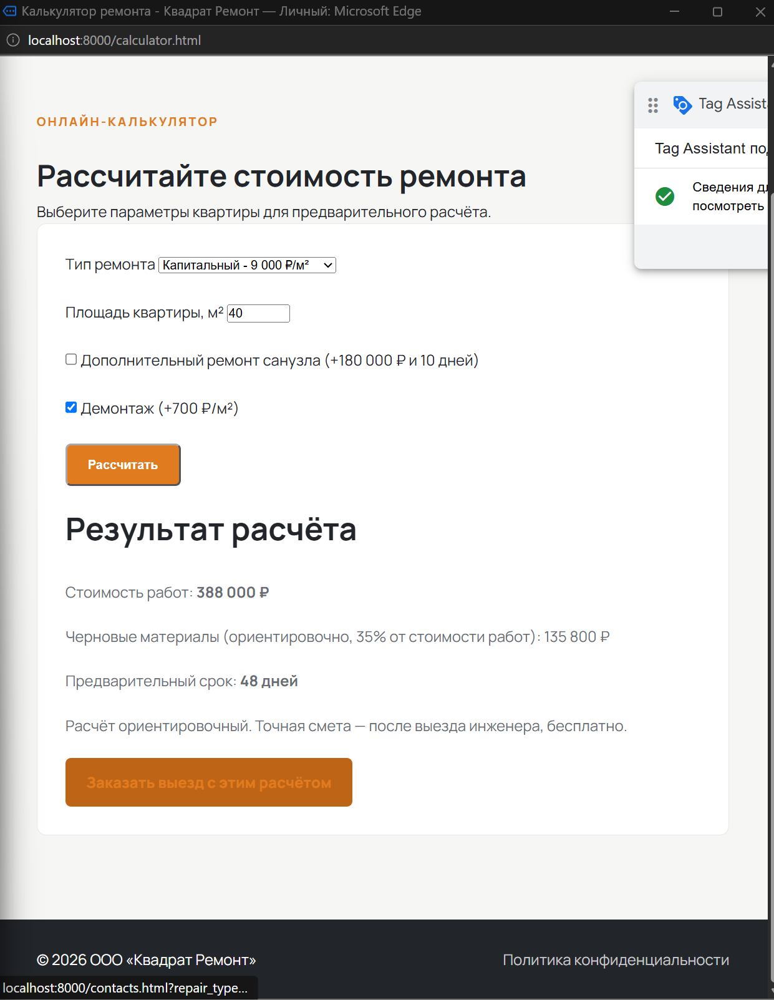
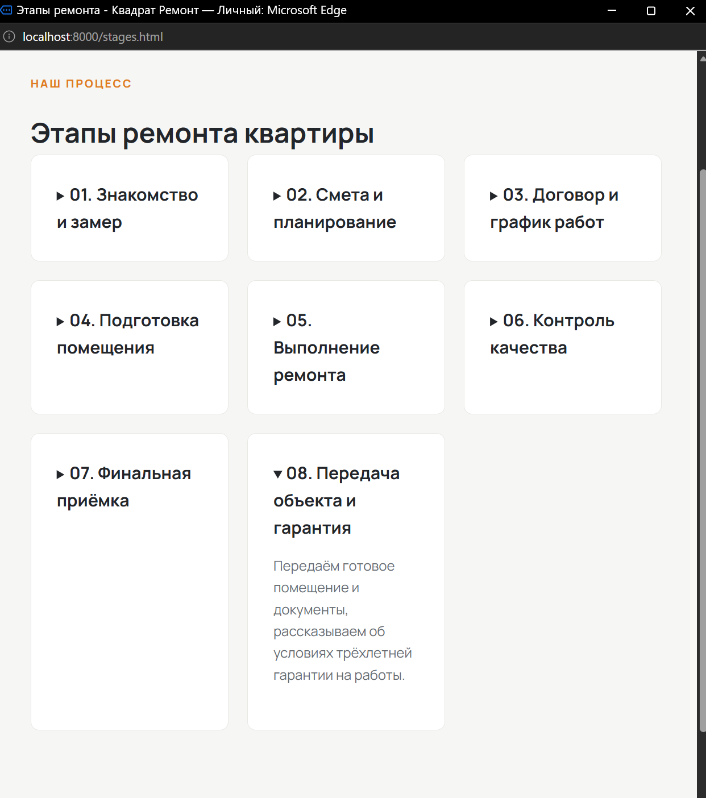
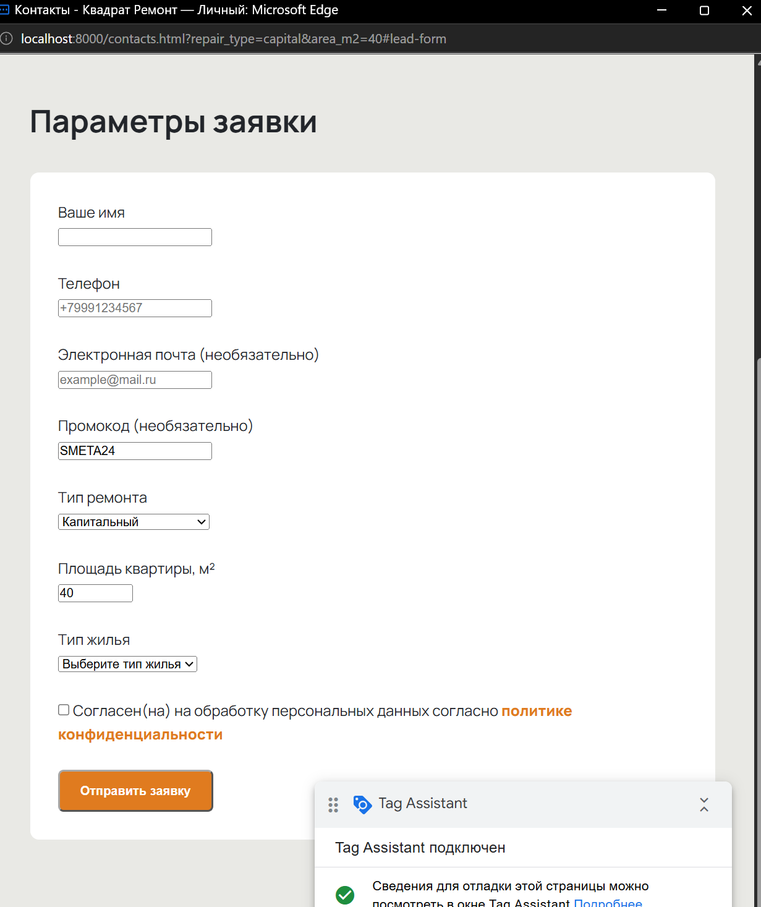
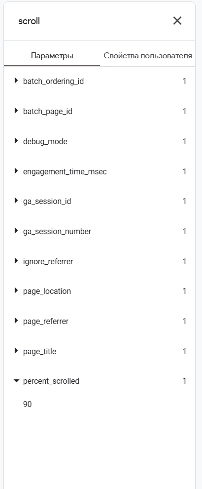
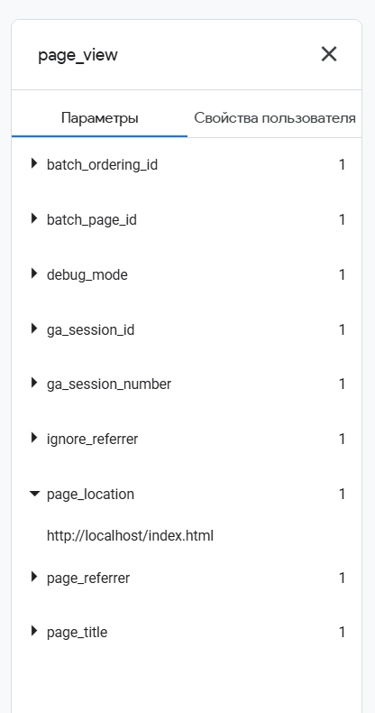

# Каталог скриншотов и доказательств

Этот файл — путеводитель по визуальным материалам проекта «Квадрат Ремонт»: что уже сохранено в репозитории, что подтверждено в ходе работы, но осталось только в переписке, и какие снимки ещё нужно сделать для итоговой сдачи.

## Как читать статусы

- **Файл сохранён** — изображение физически находится в `screens/` и показано ниже.
- **Проверено, снимок не сохранён** — пользователь проверил результат в браузере, GA4, Apps Script или Google Sheets, но соответствующего файла изображения в репозитории сейчас нет.
- **Не проверено / предстоит** — подтверждения выполнения пока нет; в план включён снимок, который поможет закрыть пункт.
- Скриншот иллюстрирует проверку, но сам по себе не заменяет требование ТЗ, тест или рабочую настройку сервиса.

**Важно:** полученный архив содержал 137 PNG. Из него в `screens/` сохранены 54 отобранных кадра; вместе с тремя PNG, которые уже были в репозитории, сейчас там 57 изображений; повторы и служебные кадры не копировались. Скриншоты с посторонними лицами и с данными развёртывания Apps Script исключены. В копии страницы благодарности скрыт номер заявки. Сохранённые кадры иллюстрируют только то, что видно на изображении, и не заменяют проверку исходных настроек или ТЗ.

## Уже сохранённые изображения

### `ga4/ga4-realtime-overview.png`

**Что на снимке:** обзорный экран GA4 Realtime с общими событиями и активностью.  
**Для чего:** общий визуальный пример работы потока данных и поступления событий.  
**Чего он не доказывает:** не показывает раскрытые параметры конкретного события и не заменяет DebugView.  
**Статус:** файл сохранён. Название соответствует общему обзору.

### `ga4/ga4-generate-lead.png`

**Что на снимке:** обзор GA4 Realtime; видны сводные показатели/события.  
**Для чего:** иллюстрирует поступление аналитической активности в реальном времени.  
**Ограничение:** по содержимому это обзорный экран, а не подробная карточка `generate_lead` с раскрытыми `lead_repair_type`, `area_m2` и `lead_source`. Имя файла может создать впечатление, что на нём есть доказательство параметров лида; сам снимок таких параметров не подтверждает.  
**Статус:** файл сохранён; подробные значения события подтверждены отдельно в рабочем журнале/переписке, но их скриншот отсутствует в `screens/`.

### `ga4/ga4-stage-open.png`

**Что на снимке:** обзор GA4 Realtime с общей сводкой событий.  
**Для чего:** общий обзор поступления активности.  
**Ограничение:** содержимое не является раскрытой карточкой события `stage_open` и не показывает значение `stage_id`. Поэтому этот файл не следует использовать как единственное доказательство параметра этапа.  
**Статус:** файл сохранён; `stage_open` и `stage_id=stage_8` подтверждены в DebugView согласно `docs/events.md`, но отдельный снимок с параметром не лежит в папке.

## Выбранные изображения из полученного архива

Архив просмотрен, в рабочие папки проекта скопированы подходящие доказательства. Ниже — несколько обзорных миниатюр; остальные файлы перечислены в матрице и названы по событию/параметру.

### Сайт

### GA4 DebugView

В архиве нет кадра `page_view` страницы контактов с раскрытыми `page_location` и `page_title`. Проверка остаётся открытой; значение не восстановлено по догадке.

## Матрица доказательств по проекту

План привязан к статусам из `PROJECT_STATUS.md`, описанию событий `docs/events.md` и требованиям, которые нужно подтвердить документами ТЗ. Здесь не утверждается, что каждое название файла буквально прописано в ТЗ: снимки служат наглядными материалами к демонстрации и отчёту.

| № | Раздел / что показать | Подпись и назначение снимка | Что должно попасть в кадр | Статус / предлагаемый файл |
|---:|---|---|---|---|
| 1 | Главная страница | Главная страница сайта и основная навигация | Шапка, заголовок и CTA | Файл сохранён: `site/home.png`. На кадре виден первый экран и начало следующего блока. |
| 2 | Навигация страниц | Общая навигация на основных страницах | Пункты меню на нескольких страницах | Частично: шапки видны на `site/home.png`, `site/contacts-form.png`, `site/thanks.png`; единого сравнительного кадра всех страниц нет. |
| 3 | Услуги | Три предлагаемых формата ремонта | Косметический, капитальный, дизайнерский ремонт | Файл сохранён: `site/services.png`. |
| 4 | Калькулятор — выбор | Форма выбора параметров | Пустой обязательный пункт типа ремонта и дополнительные опции | Файл сохранён: `site/calculator-form.png`; кадр показывает обязательный пустой выбор и сообщение браузерной проверки. |
| 5 | Калькулятор — контрольный результат | Проверка расчёта по примеру И-13 | 40 м², капитальный ремонт, демонтаж; 388 000 ₽ работы, 135 800 ₽ материалы, 48 дней | Файл сохранён: `site/calculator-control-I13.png`; на снимке видны все значения. |
| 6 | Переход из калькулятора в заявку | Параметры расчёта передаются в форму заявки | URL/форма с выбранным типом и площадью; контактные поля пустые | Снимок сохранён в `site/promo-autofill.png`; в URL указаны `repair_type=capital` и `area_m2=40`, контактные поля пустые. |
| 7 | Портфолио — демонстрационные карточки | AI-визуализации обозначены как демонстрационные примеры | Три карточки и предупреждение, что это не фото реальных объектов | Файл сохранён: `site/portfolio-demo-cards.png`. |
| 8 | Портфолио — фильтр | Фильтры жилья и площади меняют набор карточек | Выбранный тип жилья и соответствующие карточки | Файл сохранён: `site/portfolio-filter.png`; виден фильтр «Вторичное жильё» и две карточки. |
| 9 | Портфолио — просмотр проекта/галерея | Демонстрационный проект и увеличенная AI-визуализация | Заголовок, пояснение и изображение | Файл сохранён: `site/portfolio-gallery.png`; справа остался край окна Tag Assistant, но карточка и подпись читаемы. |
| 10 | Этапы ремонта | Восемь раскрываемых этапов процесса | Нумерация и названия этапов | Файл сохранён: `site/stages.png`; видны все восемь этапов, раскрыт восьмой. |
| 11 | Учебная анимация | Управляемая SVG-анимация проверки электрики | Название, состояние управления и пояснение учебного характера | Файл сохранён: `site/stages-animation.png`; кадр показывает учебную SVG-анимацию и пояснение, но не доказывает сам факт её запуска. |
| 12 | Образец договора | Учебный PDF, доступный для скачивания | Описание макета и ссылка | Файл сохранён: `site/sample-contract.png`; открыт раздел с пометкой об учебном макете и кнопкой скачивания. |
| 13 | Чек-лист | 25 пунктов приёмки, сгруппированных по темам | Несколько групп и нумерованные пункты | Частично сохранено: `site/checklist.png` показывает часть пунктов 23–25 и блок промокода; `site/checklist-groups.png` показывает группы и пункты 1–17. Полный список в одном кадре отсутствует. |
| 14 | PDF чек-листа | Фактический PDF, сформированный для скачивания | Открытый PDF с содержимым | Скачивание подтверждено ранее; скриншота открытого PDF в архиве нет. |
| 15 | Промокод | Копирование `SMETA24` и автозаполнение необязательного поля заявки | Блок промокода и поле формы с кодом | Файлы сохранены: `site/checklist.png` показывает подтверждение копирования; `site/promo-autofill.png` — поле `SMETA24` на форме. |
| 16 | Контакты — форма и согласие | Форма заявки с обязательными полями и согласием | Поля без введённых контактных данных | Файл сохранён: `site/contacts-form.png`; видны пустые поля и только примерные placeholder-тексты телефона/email. |
| 17 | Страница благодарности | Подтверждение успешной тестовой заявки | Успешная отправка; номер скрыт | Файл сохранён: `site/thanks.png`; номер заявки закрыт в копии подписью о скрытии. |
| 18 | Google Sheets — запись заявки | Строка лида после успешной отправки | Заголовки и тестовая строка, включая `promo_code`; исключить персональные данные | Архивные кадры с таблицей не сохранены: в них видны значения строки заявки. Снимок с редактированными персональными полями предстоит подготовить отдельно. |
| 19 | Apps Script deployment | Настройки активного веб-приложения и версия развёртывания | Версия без секретных URL и идентификаторов | Архивные кадры содержат развёртывающие URL/идентификаторы, поэтому не включены в `screens/`. Нужен безопасно обрезанный снимок без этих значений. |
| 20 | GA4 Realtime | Общий поток событий в реальном времени | Обзорное окно GA4 и события | В репозитории остаются три ранее сохранённых обзорных снимка; это общий мониторинг, не подробная проверка параметров. |
| 21 | GA4 DebugView — `page_view` | Проверка адреса и заголовка страницы | Раскрытые `page_location` и `page_title` для соответствующей страницы | Файлы главной и калькулятора сохранены отдельно: `ga4/debugview-page-view-home-location.png`, `...home-title.png`, `...calculator-location.png`, `...calculator-title.png`. В полученном архиве подтверждения `contacts.html` нет; `ga4/debugview-page-view-contacts.png` предстоит получить. |
| 22 | GA4 DebugView — `scroll` | Достижение порога прокрутки | Раскрытый `percent_scrolled=90` | Файл сохранён: `ga4/debugview-scroll-90.png`. |
| 23 | GA4 DebugView — калькулятор | Проверка выбора и расчёта | `repair_type_select=capital`; параметры `repair_calc` | Файлы сохранены: `ga4/debugview-repair-type-select.png` и отдельные раскрытые значения `repair_calc` (`area_m2`, `total_price`, `days`). |
| 24 | GA4 DebugView — путь заявки | События ошибки, начала, отправки и успешного лида | Без имени, телефона и email | Файлы сохранены: `ga4/debugview-lead-flow.png`, `debugview-form-error-validation.png`, `debugview-form-error-field.png`, `debugview-form-submit.png`, а также кадры параметров `generate_lead` (`area_m2`, `lead_repair_type`, `lead_source`). |
| 25 | GA4 DebugView — промокод | Проверка события копирования промокода | `promo_copy`, `promo_code=SMETA24` | Файл сохранён: `ga4/debugview-promo-copy.png`. |
| 26 | GA4 DebugView — портфолио | Проверка фильтра, открытия проекта и увеличения фото | Параметры `object_type`, `project_id`, `repair_type`, `photo_index` | Файлы сохранены в `ga4/` отдельно по событию и раскрытому параметру; полный список см. в каталоге файлов ниже. |
| 27 | GA4 DebugView — этапы и файл | Проверка раскрытия этапа и скачивания PDF | `stage_id`, имя/расширение файла, текст ссылки | Файлы сохранены: `ga4/debugview-stage-open.png` и снимки скачивания договора/чек-листа с доступными параметрами. |
| 28 | GA4 DebugView — видео | Запуск учебной SVG-анимации | `video_play`, `video_title=Как мы принимаем электрику` | Файл сохранён: `ga4/debugview-video-play.png`. |
| 29 | GA4 DebugView — CTA и контакты | Разные зоны и типы кликов без значений контактов | `button_name`, `page_section`, `contact_type`, `messenger` | Файлы сохранены: `ga4/debugview-cta-*`, `debugview-contact-click.png`, `debugview-messenger-click.png`; персональные значения не раскрыты. |
| 30 | GA4 DebugView — соцсети | Различение ссылки и места на странице | `social_click`, `network`, `page_section` | Файлы сохранены для Instagram в подвале и на странице `thanks`: `ga4/debugview-social-footer-*` и `debugview-social-thanks-section.png`. |
| 31 | Реестр UTM | Подготовленные U-01—U-12 | Таблица со статусом черновика и незаполненными полями, не подменять реальные публикации | Файл `docs/utm.csv` есть; снимка таблицы нет. `utm/utm-register.png` |
| 32 | GA4 Reports / Explore | Отчёты и исследование по требованиям ТЗ | Название отчёта, измерения/метрики и данные выбранного периода | Настройка и снимки ещё предстоят. `reports/ga4-report.png`, `explore/funnel-exploration.png` |
| 33 | Yandex DataLens | Дашборд по трафику, заявкам и кампаниям | Названия вкладок и графики с источником данных/периодом | Дашборд/снимки не обнаружены; предстоит. `datalens/dashboard.png` |
| 34 | Lighthouse / мобильная версия | Проверка качества и адаптивности | Мобильный отчёт Lighthouse, URL/режим устройства, итоговые оценки; отдельно — ширина 375 px | Результаты пока не подтверждены; предстоит. `lighthouse/mobile-report.png`, `lighthouse/mobile-375.png` |
| 35 | Курсовая и тестовые сценарии | Доказательства реализации И-01—И-13 и итоговая документация | Короткие снимки ключевых результатов сценариев; персональные данные тестовые/скрыты | Проход сценариев и документация ещё требуют итоговой сверки; предстоит. `kursovaya/` |

## Где лежат материалы

Папки `ga4`, `utm`, `instagram`, `reports`, `explore`, `datalens`, `lighthouse` и `kursovaya` подготовлены для распределения доказательств по темам. Наличие `.gitkeep` означает только, что папка включена в структуру Git; это **не** означает, что снимки уже сделаны.

## Правила сохранения новых скриншотов

1. Сохранять кадр в указанную выше папку проекта, а не оставлять только во временной папке Windows или в чате.
2. Использовать предложенное имя файла и не перезаписывать уже сохранённые снимки без причины.
3. Для GA4 DebugView выбирать конкретное событие и раскрывать именно те параметры, которые проверяем. Общий Realtime-экран параметров события не доказывает.
4. Для Sheets, форм и отчётов использовать тестовые данные; скрывать телефон, email, токены, идентификаторы доступа и иные секреты.
5. После добавления снимка изменить его статус в таблице на **Файл сохранён** и при необходимости добавить его миниатюру в раздел «Уже сохранённые изображения».

## Точка продолжения

Папка проекта не содержит архив всех изображений, отправленных в чат. Чтобы продолжить без потери состояния, сначала проверяем `page_view` на странице контактов: в GA4 DebugView раскрываем `page_location` и `page_title`, затем сохраняем снимок как `screens/ga4/debugview-page-view-contacts.png`. После этого продолжаем по ближайшему шагу в `PROJECT_STATUS.md` и уточняем статусы каталога.
